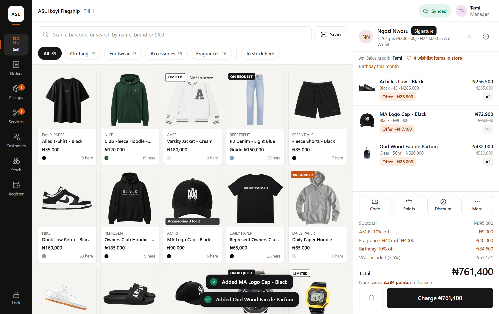
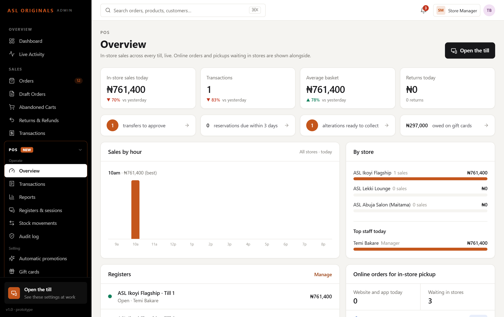
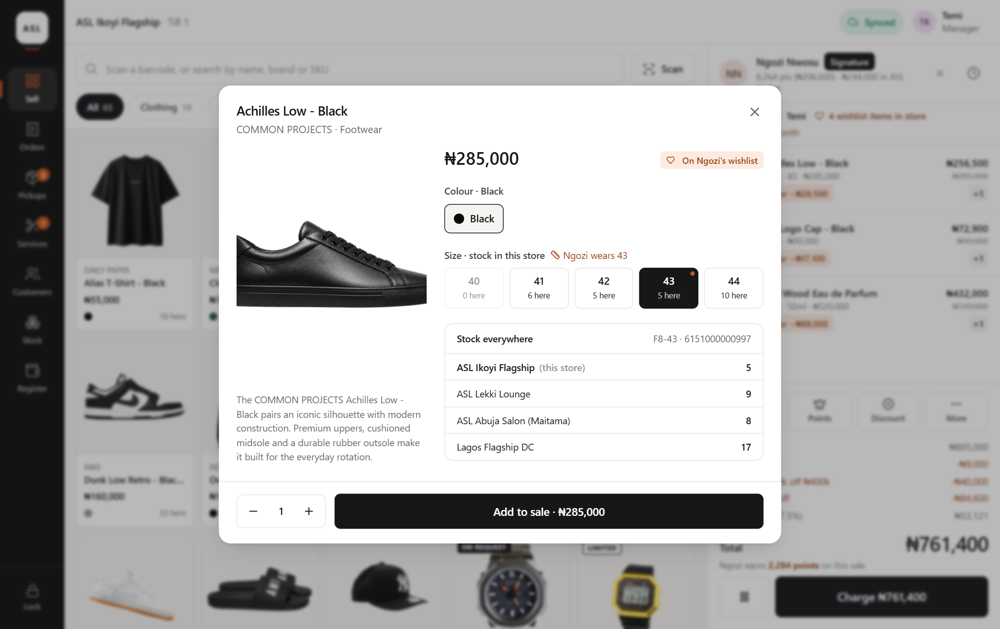
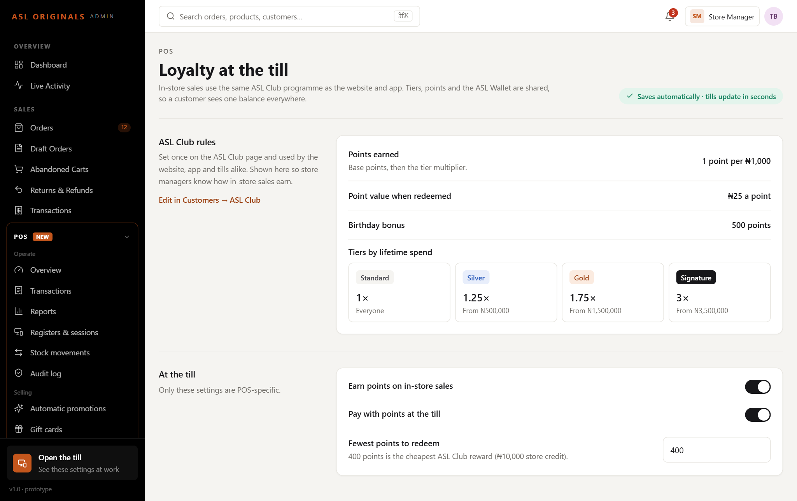
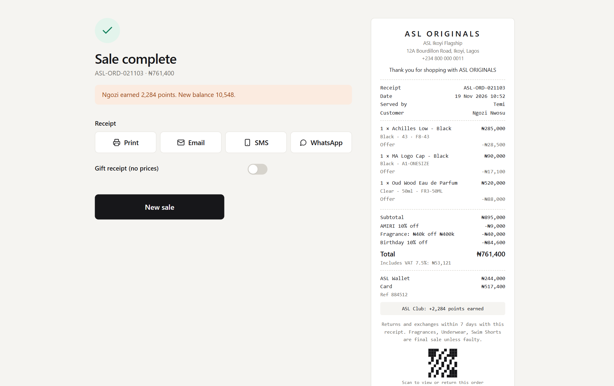
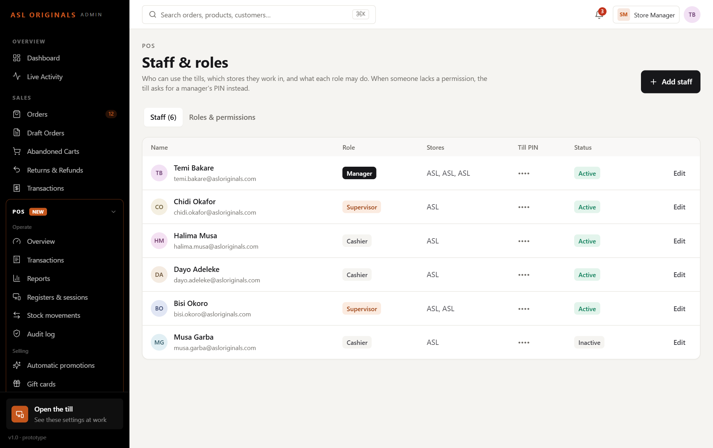
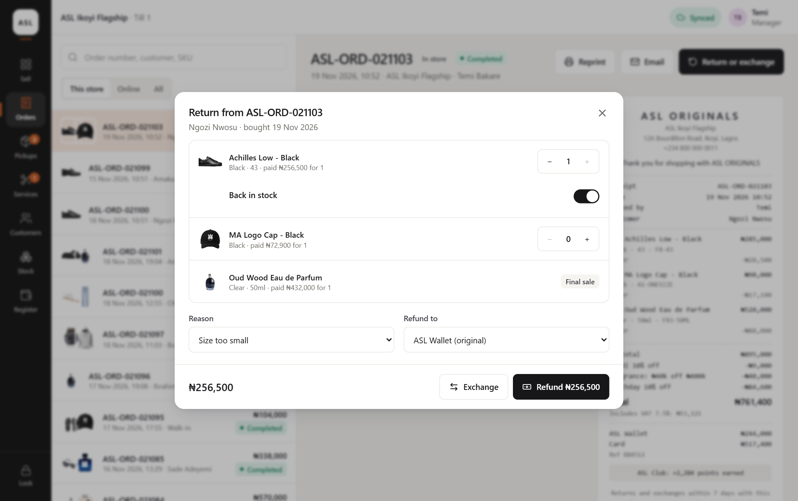
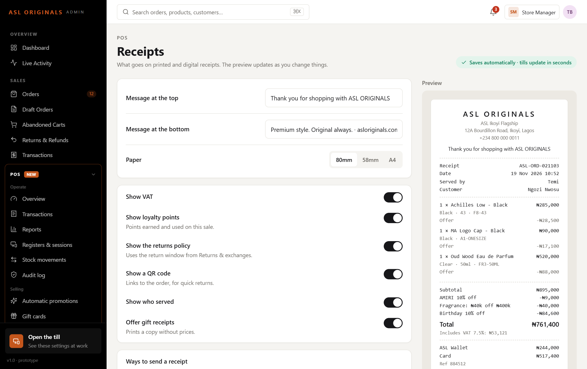
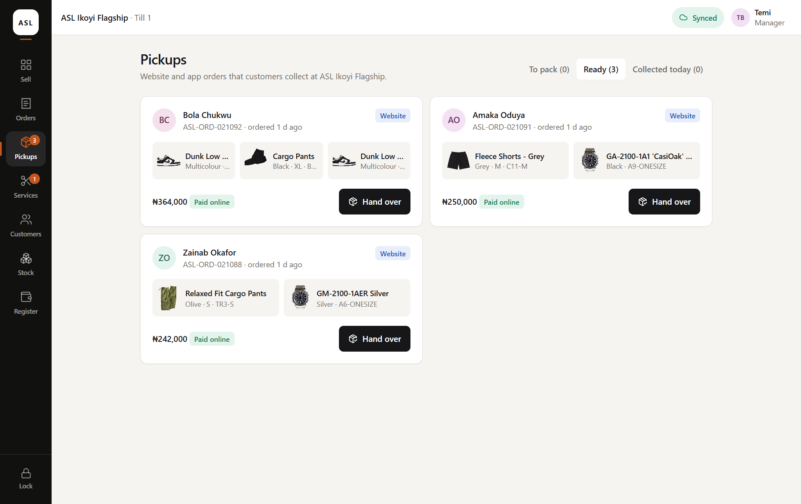

# ASL ORIGINALS POS: interactive prototype

A clickable prototype of two things, built to fit the existing ASL ORIGINALS website, app and admin:

1. **The till** (`/`): the point of sale staff use on a tablet in the boutiques.
2. **The POS menu for the admin** (`/#pos-overview`): a new **POS** group in the existing admin menu, straight after Sales, with the same look as the admin.

**It uses the app's own data:**

- the same 65 products and photos, and the same SKUs (`F1-42`)
- the same boutiques: LOC-1001 Ikoyi Flagship, LOC-1002 Lekki Lounge, LOC-1003 Abuja Salon
- the same customers (`cus_1000`…)
- ASL Club tiers and rules, and the ASL Wallet
- the admin's coupon codes and shipping zones
- `ASL-ORD-` order numbers

**For the developers: [docs/INTEGRATION.md](docs/INTEGRATION.md)** explains how the POS plugs into the existing app. It covers what the app needs to change, what is new, and the inconsistencies in the app to settle first.

**This is a prototype, not production code.** Everything runs in the browser on sample data, with no backend. The till and the admin share one set of data, saved in the browser and kept in step between tabs. Change a setting in the admin and the till follows. The developers build the real version against the store's own backend.

| Till | Admin |
| --- | --- |
|  |  |
|  |  |
|  |  |
|  |  |
|  | |

## Try it

```bash
pnpm install
pnpm dev
```

Open http://localhost:5173 for the till and http://localhost:5173/#pos-overview for the admin. Open both in two tabs side by side.

Sample PINs: **Temi 1234** (manager), **Chidi 2468** (supervisor), **Halima 1111** (cashier). Sign in as Halima to see approvals: discounts over 10%, returns, price changes and cash movements ask for a supervisor's or manager's PIN.

Things to try:

- **Ngozi Nwosu.** Add her as the customer: Signature tier, birthday this month, ₦244,000 in her ASL Wallet.
  - Open the Common Projects Achilles Low. Her size 43 is already picked, and it's on her wishlist.
  - Add an AMIRI cap and Tom Ford Oud Wood. The offers stack, and she earns 3× points.
  - Pay part from her ASL Wallet or with gift card `GC-1937-2286`, or turn on *Reserve with a deposit*.
  - Open a size showing "0 here" and choose *Ship to customer* or *Concierge request*.
- **Website pickups.** In the admin Overview, choose **Place a website order for Ikoyi pickup**. The till pops up an alert, and the order appears under Pickups.
- **Settings follow through.** In the admin, turn off **Bank transfer** under Payment methods, or change the receipt footer. The till follows straight away.
- **Offline.** On the till, open the staff menu (top right) and choose **Simulate going offline**. Sell something: it's marked "Not synced" in the admin until you go back online.

To reset all sample data, clear the site data for localhost in the browser.

## What the till does

- **Sign in and open:** sign in with a PIN, then open the register with a counted float.
- **Sell:**
  - The website's product photos, categories and badges: sale %, On Request (guide price), Limited, Pre-order.
  - Barcode or SKU scan.
  - Size picker showing stock in this boutique, the other boutiques and Lagos Flagship DC, with a button to request a transfer.
- **Basket:**
  - Customer accounts shared with the website and app, with ASL Club tier and points.
  - Coupon codes from the admin. Codes without the In store channel are refused.
  - Item and whole-sale discounts, with role limits and manager approval.
  - Price changes, points redemption, notes and parked sales.
- **Pay:** cash with quick amounts and change, card on a terminal with an approval code, bank transfer showing the store's account, ASL Wallet, gift cards, and split payments.
- **Receipt:** print, email, SMS, WhatsApp, gift receipt.
- **Orders:**
  - In-store and online orders, and reprints.
  - Returns and exchanges against the original order, inside the return window. Large or late refunds need approval.
  - Fragrances, underwear and swimwear are final sale unless faulty.
- **Pickups:** website and app orders to pack, mark ready, and hand over with the pickup code or an ID check.
- **Customers:**
  - Profile, with ASL Club tier, perks and progress.
  - Points, ASL Wallet, and orders across channels.
  - Clienteling: saved sizes (pre-selected on products), the customer's app wishlist with what's in store, and open reservations, alterations and concierge requests.
- **Stock:**
  - Size grid for this boutique and the others.
  - Adjustments, counts by scanning, and supplier deliveries received by scanning.
  - Transfers between locations: request, pack and send, receive.
- **Register:** session totals, pay in and out, close with a note-by-note count and a Z report.
- **Offline:** keeps selling, queues sales and syncs on reconnect. Installs as an app (PWA).
- **Automatic promotions:** buy 2 get 1, brand or category sales, spend-and-save and birthday-month offers apply on their own. They show on the tiles, basket and receipt.
- **Gift cards:** sell any amount, take them as payment, check a balance. They expire after 12 months.
- **Reservations:** take a deposit (50% minimum, as for drops on the website) and set the items aside. Pay the balance or cancel from Services.
- **Alterations:** book hemming and fitting, and track each one from received to with the tailor, ready and collected.
- **Ship to customer:** sell an item the boutique doesn't have and send it from the warehouse or another boutique, using the admin's shipping zones.
- **Concierge requests:** for a piece the boutique doesn't have. The request goes to the admin's Requests Inbox with the client's ASL Club priority.
- **Sales credit:** each sale and item is credited to a sales associate, for targets and commission.

## The admin POS menu

| Sub-menu | What it controls |
| --- | --- |
| Overview | Live in-store sales, sales by hour, by boutique and staff, register status, pickups waiting, activity |
| Transactions | Every till sale with filters by boutique, staff, date and channel, plus receipt and returns |
| Reports | Sales by product, category, brand and size. Staff sales with commission and target. Discounts and promotions. Returns by reason. Payments and daily reconciliation. |
| Registers & sessions | Tills per boutique and their devices. Session history with Z reports and cash differences. |
| Stock movements | Approve, ship and receive transfers. Supplier deliveries. Stock counts with differences. |
| Audit log | Discount approvals, price changes, refunds, cleared sales, cash in and out, stock changes, gift cards, reservations, concierge requests |
| Automatic promotions | Offers the tills apply on their own, by channel, boutique and date |
| Gift cards | Balances owed, history, issue, adjust or cancel a card |
| Stores | The boutiques (the admin's pickup locations), addresses on receipts, opening hours |
| Staff & roles | Store staff, till PINs and boutiques. A permission grid per role, and discount limits. |
| Payment methods | Cash quick amounts, card terminal provider, bank transfer accounts, ASL Wallet, points, split payments |
| Checkout & discounts | VAT, when a customer is required, discount reasons, which coupon codes work in store |
| Receipts | Header, footer, what's shown, paper size, ways to send, with a live preview |
| Returns & exchanges | Return window, receipt rule, refund methods, approval limit, restocking, reasons |
| Cash management | Default float, blind close, accepted difference, notes and coins, pay in and out reasons |
| Loyalty at the till | ASL Club rules, shown read-only (edit them on the ASL Club page), and earning and redeeming in store |
| Hardware | Printer, scanner, cash drawer and terminal per register |
| Offline & sync | Offline selling, the largest offline sale, oversell rule, refresh rate, device status |
| Services | Reservation deposit and hold period. Alteration price list and tailors. Delivery zones and fees. Gift card amounts and expiry. |
| Commission | Commission rate per role, who gets the credit, monthly targets per person |

The other menu groups (Overview, Sales, Concierge, Catalog, Customers, Marketing, Content, Fulfilment, Finance, Analytics, Support, System) are the existing admin. In the prototype each one opens a placeholder that says what the POS adds to that page.

## For the developers

- **Where things are:**
  - Screens are in `src/till` and `src/admin`. Shared pieces are in `src/shared` and `src/ui`.
  - The data shapes are in `src/data/types.ts`. Their comments name the matching file in the app.
- **Sample data:**
  - `src/data/catalog.ts` is generated from the website's `shop-data.ts`.
  - `src/data/seed.ts` follows the admin's own sample data: customers, club, coupons, pickups and zones.
- **Backend calls:** `src/data/store.ts` stands in for the backend. Everything that changes data (selling, returns, stock, sessions, settings) goes through it, which shows where API calls are needed.
- **Pricing rules:** discount order, points, VAT included in prices and refund splits are in `src/lib/pricing.ts`, with tests (`pnpm test`). The backend should apply the same rules.
- **Not real in this prototype:**
  - No payments are taken.
  - Receipts aren't actually sent, or printed to a device.
  - PINs sit in the frontend.
  - Sync is simulated.

Product photos are the ASL ORIGINALS app's own product images.
